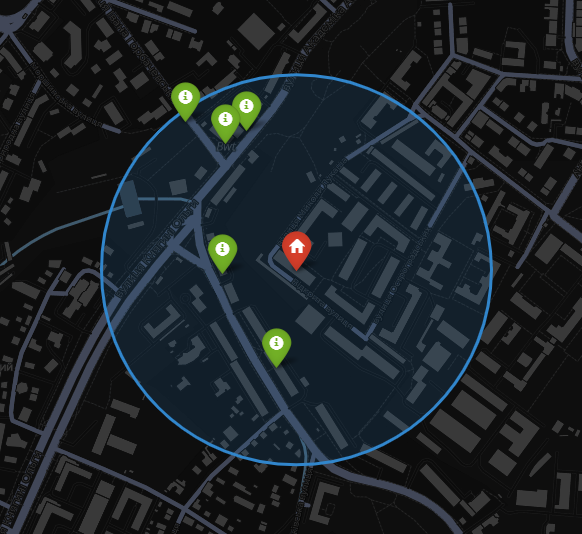

# Nearby Places Map
A Python command-line tool that takes an address and a radius, finds nearby cafés, pharmacies or restaurants, and shows them on an interactive map.


## Features
- Address geocoding via Nominatim (OpenStreetMap)
- Place search via Overpass API (nodes, buildings and complex objects)
- Interactive map saved as `map.html` (folium + CARTO basemap)
- Input validation, request timeouts, retries and a fallback Overpass server
## Tech stack
Python 3.10+, `requests`, `folium`, `python-dotenv`, Nominatim, Overpass API, CARTO Basemaps
## Installation
```bash
git clone https://github.com/skkdi9s/nearby-places-map.git
cd nearby-places-map
python -m venv .venv
# Windows (PowerShell): .venv\Scripts\Activate.ps1
# macOS/Linux: source .venv/bin/activate
pip install -r requirements.txt
```
## Configuration
Copy `.env.example` to `.env` and fill in the values:
| Variable | Description |
|---|---|
| `Nominatim_User_Agent` | App name and contact, e.g. `NearbyPlacesMap/1.0 (you@example.com)`. Required by the Nominatim usage policy |
| `Carto_Api` | CARTO Basemaps key ([get one](https://carto.com/basemaps/apikey)). Optional: without it the map falls back to OpenStreetMap tiles |
## Usage
```bash
python main.py
```
Example session:
```
Enter an address (e.g. Lviv, Rynok Square 1 ): Lviv, Rynok Square 1
Enter radius in meters (1-5000): 500
Choose place type: 1
Cafes: found 42 within 500 m
Map saved to map.html
```
Open `map.html` in your browser.
## How it works
```
address → Nominatim → coordinates → Overpass (nwr + out center) → places list → folium → map.html
```
The code is split into functions: `geocode`, `build_query`, `fetch_overpass`, `parse_elements`, `build_map`, and `main` ties them together.
## Limitations
- Data comes from OpenStreetMap, so places missing from OSM will not be found.
- Only `amenity=cafe|pharmacy|restaurant` tags are searched.
- Public Overpass servers have rate limits.
## Roadmap
- [ ] More tags (`shop=coffee`, `fast_food`)
- [ ] Place type via command-line arguments (`argparse`)
- [ ] Unit tests for `parse_elements`
- [ ] Web interface

- [ ] Thanks for checking out the project! 🙌
